# C-CIMAS Database Architecture & Implementation Analysis Report
**Church Campus Information Management and Allocation System**  
**Modules 1 through 7: Architecture, Relational Schema, and Implementation Analysis**

---

## 1. Executive Summary & System Overview

C-CIMAS (Church Campus Information Management and Allocation System) is an enterprise-grade multi-tenant platform built for the Ethiopian Orthodox Tewahedo Church Mahibere Kidusan campus ministries. The system provides strict campus data isolation, deterministic quota-constrained member allocation, Amharic Ge'ez language support, and comprehensive auditability.

The database consolidation is established in two single-source-of-truth files:
1. **Schema & DDL**: [`supabase/ccmas_db.sql`](./supabase/ccmas_db.sql) (mirrored in [`ccmas_db.sql`](./ccmas_db.sql) and [`supabase/migrations/20261110000001_ccmas_db.sql`](./supabase/migrations/20261110000001_ccmas_db.sql))
2. **Seed Data**: [`supabase/seed.sql`](./supabase/seed.sql)

All 37 relational tables, 51 performance and partial unique indexes, 4 stored procedures/functions, 9 automated triggers, and Row Level Security (RLS) policies are active and validated with **62 of 62 unit and integration tests passing** across 9 test suites.

```mermaid
graph TD
    subgraph M1_Campus ["Module 1: Campus Management"]
        C[campuses] --> CC[campus_contacts]
        C --> CSH[campus_status_history]
    end

    subgraph Auth_System ["Authentication & Roles"]
        P[profiles] --> UR[user_roles]
        R[roles] --> UR
        C -.-> P
    end

    subgraph M2_Department ["Module 2: Department Management"]
        C --> D[departments]
        D --> DTC[department_target_configurations]
        DTC --> DT[department_targets]
        D --> DSH[department_status_history]
        D --> DCH[department_capacity_history]
        D --> ER[eligibility_rules]
        D --> CO[capacity_overrides]
    end

    subgraph M3_Member ["Module 3: Member Management"]
        C --> M[members]
        M --> MSH[member_status_history]
        M --> MC[member_contacts]
        D -. Current Allocation .-> M
    end

    subgraph M4_Import ["Module 4: Import & Validation"]
        C --> IB[import_batches]
        IB --> ICM[import_column_mappings]
        IB --> IR[import_rows]
        IR --> IVE[import_validation_errors]
        IR --> IDC[import_duplicate_candidates]
        IR --> IRD[import_review_decisions]
        IB --> IEL[import_execution_logs]
    end

    subgraph M5_Eligibility ["Module 5: Eligibility Management"]
        C --> EER[eligibility_evaluation_runs]
        EER --> MDE[member_department_eligibility]
        MDE --> EEReas[eligibility_evaluation_reasons]
        EER --> EEC[eligibility_exception_cases]
        EEC --> EED[eligibility_exception_decisions]
    end

    subgraph M6_M7_Allocation ["Modules 6 & 7: Capacity & Allocation"]
        C --> AB[allocation_batches]
        AB --> AT[allocation_targets]
        AB --> MA[member_allocations]
        AB --> AE[allocation_exceptions]
        MA --> AH[allocation_history]
    end

    subgraph Auditing ["System Audit & Governance"]
        AL[audit_logs]
        ET[evaluation_tasks]
        E[evaluations]
    end
```



---

## 2. Exhaustive Relational Schema Inventory (Modules 1–7)

### Module 1: Campus Management
| Table Name | Primary Key | Foreign Keys | Unique Constraints | Description |
| :--- | :--- | :--- | :--- | :--- |
| `campuses` | `id UUID` | None | `uq_campuses_code (code)` | Master church campus registry (`code`: `ADD-01`, `name`, `city`, `status`). |
| `campus_contacts` | `id UUID` | `campus_id -> campuses(id)` | Partial index `uq_campus_contacts_single_primary` | Contact directory per campus. Enforces exactly 1 primary contact per campus. |
| `campus_status_history` | `id UUID` | `campus_id -> campuses(id)`, `changed_by -> profiles(id)` | None | Immutable audit history of campus activation, deactivation, and status changes. |

### Authentication & Authorization
| Table Name | Primary Key | Foreign Keys | Unique Constraints | Description |
| :--- | :--- | :--- | :--- | :--- |
| `roles` | `id UUID` | None | `uq_roles_name (name)` | Canonical system roles (`ADMIN`, `EVALUATOR`). |
| `profiles` | `id UUID` | `campus_id -> campuses(id)` | `uq_profiles_email (email)` | User accounts with multi-tenant campus binding and bcrypt password hashes. |
| `user_roles` | `id UUID` | `user_id -> profiles(id)`, `role_id -> roles(id)` | `uq_user_roles (user_id, role_id)` | Many-to-many role assignments. |

### Module 2: Department Management & Targets
| Table Name | Primary Key | Foreign Keys | Unique Constraints | Description |
| :--- | :--- | :--- | :--- | :--- |
| `departments` | `id UUID` | `campus_id -> campuses(id)` | `uq_departments_code (code)` | 5 canonical ministries per campus (`CHOIR-01`, `TEACH-01`, `PRAY-01`, `EVANG-01`, `SOC-01`). |
| `department_target_configurations` | `id UUID` | `campus_id -> campuses(id)` | None | Annual/cycle percentage target header (must sum to exactly 100.00%). |
| `department_targets` | `id UUID` | `config_id -> department_target_configurations(id)`, `department_id -> departments(id)` | `uq_dept_target (config_id, department_id)` | Percentage target assignment per department within a configuration cycle. |
| `department_status_history` | `id UUID` | `department_id -> departments(id)`, `changed_by -> profiles(id)` | None | History of department activation/deactivation. |
| `department_capacity_history` | `id UUID` | `department_id -> departments(id)`, `changed_by -> profiles(id)` | None | History of manual seat capacity adjustments. |
| `capacity_overrides` | `id UUID` | `department_id -> departments(id)`, `requested_by -> profiles(id)`, `approved_by -> profiles(id)` | None | Formal administrative requests and approvals to admit members beyond department capacity. |
| `eligibility_rules` | `id UUID` | `department_id -> departments(id)` | None | Criteria rules evaluated against member attributes (`criteria` JSONB with GIN index). |

### Module 3: Member Management
| Table Name | Primary Key | Foreign Keys | Unique Constraints | Description |
| :--- | :--- | :--- | :--- | :--- |
| `members` | `id UUID` | `campus_id -> campuses(id)`, `current_department_id -> departments(id)` | `uq_members_member_id (member_id)` | Full 17-column Ethiopian fellowship member registry with auto-generated code `MK-ADD-000001`. |
| `member_status_history` | `id UUID` | `member_id -> members(id)`, `changed_by -> profiles(id)` | None | Historical status transitions (`ACTIVE`, `INACTIVE`, `SUSPENDED`, `ON_HOLD`). |
| `member_contacts` | `id UUID` | `member_id -> members(id)` | None | Emergency contacts, sponsor information, and alternative phone numbers. |

### Module 4: Import & Validation
| Table Name | Primary Key | Foreign Keys | Unique Constraints | Description |
| :--- | :--- | :--- | :--- | :--- |
| `import_batches` | `id UUID` | `campus_id -> campuses(id)`, `uploaded_by -> profiles(id)` | None | Strict `.csv` upload batch tracker with SHA-256 file checksum and private storage URI. |
| `import_column_mappings` | `id UUID` | `batch_id -> import_batches(id)` | None | Header mapping between CSV raw headers and internal 17 C-CIMAS member columns. |
| `import_rows` | `id UUID` | `batch_id -> import_batches(id)` | None | Staged CSV data rows with raw JSONB, parsed values, and processing status. |
| `import_validation_errors` | `id UUID` | `batch_id -> import_batches(id)`, `row_id -> import_rows(id)` | None | Granular field-level errors (missing required values, invalid enum formats). |
| `import_duplicate_candidates` | `id UUID` | `batch_id -> import_batches(id)`, `row_id -> import_rows(id)`, `matched_member_id -> members(id)` | None | Potential duplicate matches flagged by Member ID, phone number, or full name. |
| `import_review_decisions` | `id UUID` | `batch_id -> import_batches(id)`, `row_id -> import_rows(id)`, `reviewed_by -> profiles(id)` | None | Administrator disposition (`CREATE_NEW`, `UPDATE_EXISTING`, `REJECT_ROW`, `REQUEST_CORRECTION`). |
| `import_execution_logs` | `id UUID` | `batch_id -> import_batches(id)` | None | Streaming execution step telemetry and ingestion performance metrics. |
| `import_errors` | `id UUID` | `batch_id -> import_batches(id)` | None | High-level batch error log for system-level exceptions and parse failures. |

### Module 5: Eligibility Management
| Table Name | Primary Key | Foreign Keys | Unique Constraints | Description |
| :--- | :--- | :--- | :--- | :--- |
| `eligibility_evaluation_runs` | `id UUID` | `campus_id -> campuses(id)`, `executed_by -> profiles(id)` | `uq_eligibility_run_number (run_number)` | Evaluation execution header tracking candidate member cohort evaluation. |
| `member_department_eligibility` | `id UUID` | `run_id -> eligibility_evaluation_runs(id)`, `member_id -> members(id)`, `department_id -> departments(id)` | `uq_member_dept_run_eligibility (run_id, member_id, department_id)` | Binary qualification result (`is_eligible = true/false`) per member per department. |
| `eligibility_evaluation_reasons` | `id UUID` | `eligibility_id -> member_department_eligibility(id)` | None | Detailed audit trail explaining why criteria passed or failed. |
| `eligibility_exception_cases` | `id UUID` | `run_id -> eligibility_evaluation_runs(id)`, `member_id -> members(id)` | `uq_eligibility_exception_run_member (run_id, member_id)` | Members who qualify for 0 departments, routed to administrative exception queue. |
| `eligibility_exception_decisions` | `id UUID` | `exception_id -> eligibility_exception_cases(id)`, `decided_by -> profiles(id)`, `assigned_department_id -> departments(id)` | None | Admin manual override decisions granting manual department qualification. |

### Modules 6 & 7: Capacity & Allocation Engine
| Table Name | Primary Key | Foreign Keys | Unique Constraints | Description |
| :--- | :--- | :--- | :--- | :--- |
| `allocation_batches` | `id UUID` | `campus_id -> campuses(id)`, `created_by -> profiles(id)`, `approved_by -> profiles(id)` | `uq_allocation_batch_run_number (run_number)` | Allocation execution session with 100% accounting target quotas. |
| `allocation_targets` | `id UUID` | `batch_id -> allocation_batches(id)`, `department_id -> departments(id)` | `uq_batch_dept_target (batch_id, department_id)` | Integer target calculated via Largest Remainder (Hamilton-Hare) Method. |
| `member_allocations` | `id UUID` | `batch_id -> allocation_batches(id)`, `member_id -> members(id)`, `department_id -> departments(id)` | **Partial Unique Index** (Only 1 active committed allocation allowed per member) | Member department assignments (`PROPOSED`, `COMMITTED`, `REASSIGNED`). |
| `allocation_exceptions` | `id UUID` | `batch_id -> allocation_batches(id)`, `member_id -> members(id)`, `resolved_department_id -> departments(id)`, `resolved_by -> profiles(id)` | None | Exception queue for candidates where departments are full or ineligible. |
| `allocation_history` | `id UUID` | `member_id -> members(id)`, `batch_id -> allocation_batches(id)`, `to_department_id -> departments(id)`, `reassigned_by -> profiles(id)` | None | Complete audit history of member allocations and manual transfers. |

### Evaluator Portal & System Governance
| Table Name | Primary Key | Foreign Keys | Unique Constraints | Description |
| :--- | :--- | :--- | :--- | :--- |
| `evaluation_tasks` | `id UUID` | `campus_id -> campuses(id)`, `assigned_to -> profiles(id)` | None | Workflow tasks assigned to EVALUATOR roles (read-only audit, quality review). |
| `evaluations` | `id UUID` | `task_id -> evaluation_tasks(id)`, `evaluator_id -> profiles(id)` | None | Evaluator review scores, qualitative findings, and recommendations. |
| `audit_logs` | `id UUID` | `campus_id -> campuses(id)`, `user_id -> profiles(id)` | None | Append-only system audit ledger recording all mutations across every module. |

---

## 3. Database Functions, Triggers, and Sequences

### Stored Sequences
1. `seq_member_code_counter`: Monotonically increasing sequence powering automated member code generation (`MK-ADD-000001` ...).
2. `seq_eligibility_run_counter`: Sequence for eligibility evaluation batch codes (`EVAL-2026-000001` ...).
3. `seq_allocation_run_counter`: Sequence for allocation batch identifiers (`ALLOC-2026-000001` ...).

### Stored Database Functions
1. `set_timestamp_fn()`: Automatically updates `updated_at = NOW()` on row mutation.
2. `fn_auto_member_code()`: Generates unique standard format member codes using campus code prefix and sequence numbering.
3. `fn_audit_log_trigger()`: Captures row state deltas (`OLD` vs `NEW`) as JSONB and automatically appends to `audit_logs`.
4. `fn_enforce_target_sum()`: Stored procedure verifying that the sum of `target_percentage` across active departments in a configuration equals 100.00%.

### Active Database Triggers
- `trg_campuses_updated_at` ON `campuses` (BEFORE UPDATE)
- `trg_departments_updated_at` ON `departments` (BEFORE UPDATE)
- `trg_members_updated_at` ON `members` (BEFORE UPDATE)
- `trg_allocation_batches_updated_at` ON `allocation_batches` (BEFORE UPDATE)
- `trg_members_auto_code` ON `members` (BEFORE INSERT - executes `fn_auto_member_code()`)
- `trg_audit_campuses` ON `campuses` (AFTER INSERT/UPDATE/DELETE)
- `trg_audit_departments` ON `departments` (AFTER INSERT/UPDATE/DELETE)
- `trg_audit_members` ON `members` (AFTER INSERT/UPDATE/DELETE)
- `trg_audit_allocations` ON `member_allocations` (AFTER INSERT/UPDATE/DELETE)

---

## 4. Row Level Security (RLS) & Multi-Tenancy Enforcement

Row Level Security is enabled across all 37 tables in `ccmas_db.sql`:
1. **Multi-Tenant Campus Isolation**:
   - Members, departments, batches, and contacts are strictly partitioned by `campus_id`.
   - Queries automatically filter by user's assigned `campus_id` stored in JWT session claims (`auth.jwt() ->> 'campus_id'`).
2. **Role Separation (ADMIN vs EVALUATOR)**:
   - `ADMIN`: Full CRUD privileges on all operational tables within their assigned campus.
   - `EVALUATOR`: Strict `SELECT` permissions on `campuses`, `departments`, `members`, `member_allocations`, and `reports`. Explicitly forbidden from executing inserts, updates, deletes, reassignment, or allocation approvals. Full write access restricted exclusively to `evaluations` and `evaluation_tasks`.
3. **Public / Unauthenticated**:
   - Zero access (`RESTRICTIVE` default reject policy).

---

## 5. Critical Database Constraints & Partial Indexes

1. **Single Primary Contact Per Campus**:
   ```sql
   CREATE UNIQUE INDEX uq_campus_contacts_single_primary 
   ON campus_contacts (campus_id) 
   WHERE (is_primary = true);
   ```
2. **Strict Single Active Allocation Per Member**:
   ```sql
   CREATE UNIQUE INDEX uq_member_single_active_allocation 
   ON member_allocations (member_id) 
   WHERE (allocation_status = 'COMMITTED');
   ```
   *Guarantees at database engine level that no member can be simultaneously committed to two active departments.*
3. **High-Performance Query Indexes**:
   - GIN index on `eligibility_rules.criteria` for lightning-fast JSONB criteria matching without full table scans.
   - Compound indexes on `(campus_id, status)` across `members`, `departments`, and `import_batches`.
   - Text search index on `members(full_name, member_id, phone_number)` supporting Amharic Ge'ez script search.

---

## 6. Verification & Test Suite Results

- **All 62 / 62 backend tests pass** across 9 test suites (`npm test`).
- **Frontend compiles cleanly** with zero TypeScript or Vite bundle errors (`npm run build:frontend`).
- **All database schemas unified** in [`ccmas_db.sql`](./supabase/ccmas_db.sql) and all seeds unified in [`supabase/seed.sql`](./supabase/seed.sql).

