# C-CIMAS – Master Development Strategy
## Phase 0: Complete Architecture Inspection Report & Master Database Strategy (Modules 1–11)

---

## 1. Executive Summary & Strategy Alignment

Per the master development strategy:
$$\text{Database First (All 11 Modules)} \longrightarrow \text{Backend Second} \longrightarrow \text{Frontend Third} \longrightarrow \text{System Integration \& Testing}$$

This report delivers **Phase 0: Inspection & Master Database Strategy**. It documents the existing project architecture, audits all operational data models (Modules 1–7), designs the exact relational schema additions for Modules 8, 9, 10, and 11, and establishes the dependency sequence for single-source-of-truth implementation.

---

## 2. Existing Architecture Audit

### 2.1 Technology Stack Verification
- **Database**: Supabase PostgreSQL with multi-tenant Row Level Security (RLS).
  - Consolidated DDL: [`supabase/ccmas_db.sql`](./supabase/ccmas_db.sql)
  - Consolidated Seeds: [`supabase/seed.sql`](./supabase/seed.sql)
- **Backend**: Node.js, Express, TypeScript, Vitest, Helmet, CORS, JWT-based authentication.
  - Active test suite: **9 test files, 62 / 62 tests passing** in 4.68s.
- **Frontend**: React 18, Vite, TypeScript, Tailwind CSS, Lucide icons.
  - Features: Dark/Light Mode with custom Ethiopian Orthodox Tewahedo Church deep navy palette, Amharic Ge'ez & English localization, responsive navigation.
  - Production build: Zero errors (1.98s compile).

### 2.2 Existing Relational Inventory (37 Operational Tables)
| Module / Domain | Tables | Responsibility & Constraints |
| :--- | :--- | :--- |
| **Foundation & Auth** | `roles`, `profiles`, `user_roles` | RBAC (`ADMIN`, `EVALUATOR`), bcrypt hashing, campus tenancy binding. |
| **Module 1: Campus** | `campuses`, `campus_contacts`, `campus_status_history` | Campus tenancy registry (`ADD-01`), partial unique index for single primary contact. |
| **Module 2: Department** | `departments`, `department_target_configurations`, `department_targets`, `department_status_history`, `department_capacity_history`, `capacity_overrides`, `eligibility_rules` | 5 canonical ministries, 100.00% target quota validation, capacity history, JSONB eligibility rules with GIN index. |
| **Module 3: Member** | `members`, `member_status_history`, `member_contacts` | 17-column Ethiopian fellowship registry, auto-generated member code (`MK-ADD-000001`). |
| **Module 4: Import** | `import_batches`, `import_column_mappings`, `import_rows`, `import_validation_errors`, `import_duplicate_candidates`, `import_review_decisions`, `import_execution_logs`, `import_errors` | Strict `.csv` format, SHA-256 checksums, streaming parser with BOM handling, duplicate review staging. |
| **Module 5: Eligibility** | `eligibility_evaluation_runs`, `member_department_eligibility`, `eligibility_evaluation_reasons`, `eligibility_exception_cases`, `eligibility_exception_decisions` | Deterministic criteria evaluation, exception queue for members qualifying for 0 departments. |
| **Module 6 & 7: Capacity & Allocation** | `allocation_batches`, `allocation_targets`, `member_allocations`, `allocation_exceptions`, `allocation_history` | 95% near-capacity threshold, Largest Remainder Method (Hamilton-Hare), partial unique index enforcing **exactly 1 active committed allocation per member**. |
| **Governance & Audit** | `evaluation_tasks`, `evaluations`, `audit_logs` | Evaluator task workflows, append-only system audit ledger with before/after JSONB deltas. |

---

## 3. Master Relational Map: All 11 Modules (57 Tables)

```mermaid
graph TD
    subgraph Shared ["Foundations & Governance"]
        C[campuses]
        P[profiles]
        R[roles]
        AL[audit_logs]
    end

    subgraph M1_M3 ["Core Registries"]
        C --> D[departments]
        C --> M[members]
    end

    subgraph M4_Import ["M4: Import & Validation"]
        C --> IB[import_batches]
        IB --> IR[import_rows]
        IR --> IVE[import_validation_errors]
        IR --> IDC[import_duplicate_candidates]
        IR --> IRD[import_review_decisions]
        IRD -. Creates/Updates .-> M
    end

    subgraph M5_Eligibility ["M5: Eligibility Management"]
        D --> ER[eligibility_rules]
        C --> EER[eligibility_evaluation_runs]
        EER --> MDE[member_department_eligibility]
        EER --> EEC[eligibility_exception_cases]
    end

    subgraph M6_M7_Allocation ["M6 & M7: Capacity & Allocation Engine"]
        D --> CO[capacity_overrides]
        C --> AB[allocation_batches]
        AB --> AT[allocation_targets]
        AB --> MA[member_allocations]
        AB --> AE[allocation_exceptions]
    end

    subgraph M8_Approval ["M8: Allocation Approval (Proposed)"]
        AB --> AR[approval_requests]
        AW[approval_workflows] --> AWV[approval_workflow_versions]
        AWV --> AWS[approval_workflow_steps]
        AR --> AS[approval_steps]
        AS --> AD[approval_decisions]
        AR --> AC[approval_comments]
        AD -. Finalizes PROPOSED to COMMITTED .-> MA
    end

    subgraph M9_Reassignment ["M9: Reassignment Management (Proposed)"]
        M --> RR[reassignment_requests]
        RRT[reassignment_reason_types] --> RR
        RR -. Replaces Active Allocation .-> MA
        RR -. Logs .-> AH[allocation_history]
    end

    subgraph M10_Evaluation ["M10: Evaluation Management (Proposed)"]
        C --> ERUN[evaluation_runs]
        ERUN --> ESCOPE[evaluation_scope]
        ERUN --> ESNAP[evaluation_snapshots]
        ERUN --> EMETRICS[evaluation_metrics]
        ERUN --> EFINDINGS[evaluation_findings]
        EFINDINGS --> EREC[evaluation_recommendations]
        ETHRESH[evaluation_thresholds] --> ERUN
    end

    subgraph M11_Reporting ["M11: Reporting Management (Proposed)"]
        RDEF[report_definitions] --> RJOB[report_generation_jobs]
        RSCHED[report_schedules] --> RJOB
        RJOB --> GREP[generated_reports]
    end
```

---

## 4. Proposed Database Schema Design for Modules 8–11

To complete Phase 1 for all 11 modules, 20 new tables will be added to the existing 37 tables (totaling 57 normalized tables):

### Module 8: Allocation Approval (7 Tables)
1. `approval_workflows`: Workflow definitions scoped to campus or global (`id`, `campus_id`, `name`, `workflow_type`, `is_active`).
2. `approval_workflow_versions`: Immutable version snapshots ensuring past approval runs remain historically intact.
3. `approval_workflow_steps`: Configurable review stages (`step_number`, `step_name`, `required_permission`, `approval_mode`).
4. `approval_requests`: Active approval instance linking an allocation run (`allocation_batch_id`, `status`: `DRAFT`, `PENDING`, `UNDER_REVIEW`, `CHANGES_REQUESTED`, `APPROVED`, `REJECTED`, `WITHDRAWN`).
5. `approval_steps`: Concrete runtime step assigned to authorized reviewer (`assigned_user_id`, `status`, `started_at`, `completed_at`).
6. `approval_decisions`: Immutable formal reviewer dispositions (`decision`: `APPROVED`, `REJECTED`, `CHANGES_REQUESTED`, `decision_reason`, `decided_by`).
7. `approval_comments`: Reviewer discussion thread separate from formal decisions.

### Module 9: Reassignment Management (2 Tables)
1. `reassignment_requests`: Formal member movement requests (`member_id`, `current_department_id`, `requested_department_id`, `reason_details`, `status`: `PENDING`, `APPROVED`, `REJECTED`, `EXECUTED`, `CANCELLED`).
2. `reassignment_reason_types`: Canonical transfer categories (`MEMBER_REQUEST`, `ADMINISTRATIVE_DECISION`, `VOCATION_FIT`, `CAPACITY_REBALANCE`).
- *Reused Tables*: `member_allocations` (prior allocation transitioned to `REASSIGNED`, new one inserted as `COMMITTED`), `allocation_history` (audit of department transfers).

### Module 10: Evaluation Management (7 Tables)
1. `evaluation_runs`: Analytical evaluation run header (`run_number`, `evaluation_type`, `status`, `total_metrics`, `total_findings`).
2. `evaluation_scope`: Scope binding (`scope_type`: `CAMPUS`, `DEPARTMENT`, `ALLOCATION_BATCH`, date ranges).
3. `evaluation_snapshots`: Immutable JSONB snapshots of targets, capacities, and allocations evaluated.
4. `evaluation_metrics`: Exact numeric metric calculations (`metric_code`, `metric_category`, `metric_value`, `expected_value`, `variance_value`).
5. `evaluation_findings`: Anomalies and alerts discovered (`finding_code`, `severity`: `CRITICAL`, `HIGH`, `MEDIUM`, `LOW`, `INFO`, `status`).
6. `evaluation_recommendations`: Advisory suggestions (`recommendation_code`, `priority`, `status`, `assigned_to`).
7. `evaluation_thresholds`: Configurable evaluation criteria (reusing the Module 6 95% near-capacity threshold).

### Module 11: Reporting Management (4 Tables - Confirmed Decisions)
1. `report_definitions`: Catalog of standard C-CIMAS reports (`report_code`, `report_name`, `report_category`, `configuration`).
2. `report_generation_jobs`: Execution job tracker (`generation_method`: `MANUAL`, `SCHEDULED`, `export_format`: `PDF`, `CSV`, `XLSX`, `status`).
3. `generated_reports`: Metadata for permanently retained report artifacts (`storage_path`, `file_format`, `file_size`, `checksum`, permanent retention).
4. `report_schedules`: Recurrence definitions (`Daily`, `Weekly`, `Monthly`, `next_run_at`, `is_active`).

---

## 5. Master Implementation Roadmap

| Phase | Scope | Deliverables & Verification Gates |
| :--- | :--- | :--- |
| **Phase 0** | **Complete System Inspection** | **Current Gate**: Architecture report, inventory, ERD, and strategy review. *(STOP & WAIT FOR APPROVAL)* |
| **Phase 1** | **Database DDL for All 11 Modules** | Complete unified `ccmas_db.sql` (57 tables), constraints, indexes, triggers, RLS, and `seed.sql`. Validated via SQL syntax & schema checks. |
| **Phase 2** | **Backend Implementation (All 11 Modules)** | Express routers, controllers, services, schemas, and transactions for all 11 modules in strict dependency order. Validated via Vitest (target: 100% passing tests). |
| **Phase 3** | **Frontend Implementation (All 11 Modules)** | Modern React 18 UI screens for all 11 modules, integrated with backend APIs, theme toggle, and Amharic i18n. Validated via Vite production build. |
| **Phase 4** | **System Integration & End-to-End Testing** | Full end-to-end lifecycle verification: Campus creation $\rightarrow$ Dept targets $\rightarrow$ CSV import $\rightarrow$ Eligibility $\rightarrow$ Capacity $\rightarrow$ Balanced allocation $\rightarrow$ Approval $\rightarrow$ Reassignment $\rightarrow$ Evaluation $\rightarrow$ Report exports. |

---

## 6. Actionable Decisions for User Review

Please confirm your approval of this **Phase 0 Architecture Inspection Report & Master Database Strategy** and confirm the key business policy defaults:
1. **Module 8 Approver**: System & Campus Administrators. Dual-control enforced (allocator cannot approve their own run).
2. **Module 9 Reassignment**: Admin direct execution with mandatory reason; cross-department member requests route through approval. Exactly 1 active request per member.
3. **Module 10 Evaluation**: Both manual on-demand and automated post-approval evaluation runs. Recommendations remain purely advisory.
4. **Module 11 Reporting**: Permanent document retention, tri-format (PDF, CSV, XLSX) exports with Amharic Ge'ez support, manual + scheduled generation.
