# C-CIMAS – Modules 8, 9, 10 & 11: Phase 1 Inspection & Architecture Analysis Report
**Church Campus Information Management and Allocation System**  
**Engineering Discipline: Database Architecture, Backend Integration, Frontend UX, Security & QA**

---

## 1. Executive Summary & Existing Project Verification

The C-CIMAS platform is an active, fully integrated enterprise system running on:
- **Database**: Supabase PostgreSQL (DDL consolidated in [`supabase/ccmas_db.sql`](./supabase/ccmas_db.sql), seeds in [`supabase/seed.sql`](./supabase/seed.sql)).
- **Backend**: Node.js, Express, TypeScript, Vitest (9 test suites, **62 / 62 tests passing**).
- **Frontend**: React 18, Vite, TypeScript, Tailwind CSS, Lucide icons, Dark/Light Theme with custom deep navy palette, Amharic/English i18n support.
- **Tenancy & Security**: Multi-tenant campus isolation enforced via Row Level Security (RLS) and JWT claim verification (`campus_id`).

Modules 1 through 7 are already active in the schema and codebase:
- **Module 1**: Campus Management (`campuses`, `campus_contacts`, `campus_status_history`).
- **Auth & Access**: Profiles, roles (`ADMIN`, `EVALUATOR`), `user_roles`.
- **Module 2**: Department Management (`departments`, `department_target_configurations`, `department_targets`, `department_capacity_history`, `capacity_overrides`, `eligibility_rules`).
- **Module 3**: Member Management (`members`, `member_status_history`, `member_contacts`).
- **Module 4**: Import & Validation (`import_batches`, `import_column_mappings`, `import_rows`, `import_validation_errors`, `import_duplicate_candidates`, `import_review_decisions`, `import_execution_logs`, `import_errors`).
- **Module 5**: Eligibility Management (`eligibility_evaluation_runs`, `member_department_eligibility`, `eligibility_evaluation_reasons`, `eligibility_exception_cases`, `eligibility_exception_decisions`).
- **Module 6**: Capacity Management (manual capacity, 95% near-capacity threshold, `capacity_overrides`).
- **Module 7**: Allocation Engine (`allocation_batches`, `allocation_targets`, `member_allocations`, `allocation_exceptions`, `allocation_history`).

As instructed, this document delivers **PHASE 1 ONLY**. No database migrations or modifying code have been executed.

---

## 2. Comprehensive Relational Map & ERD (Modules 1–11)

```mermaid
erDiagram
    campuses ||--o{ departments : "owns"
    campuses ||--o{ members : "registers"
    campuses ||--o{ allocation_batches : "runs"
    campuses ||--o{ approval_requests : "governs"
    campuses ||--o{ reassignment_requests : "scopes"
    campuses ||--o{ evaluation_runs : "analyzes"
    campuses ||--o{ report_generation_jobs : "targets"

    departments ||--o{ eligibility_rules : "defines"
    departments ||--o{ department_targets : "assigned"
    departments ||--o{ capacity_overrides : "requests"
    departments ||--o{ member_allocations : "assigned_to"

    members ||--o{ member_allocations : "holds"
    members ||--o{ member_department_eligibility : "qualifies"
    members ||--o{ reassignment_requests : "subject_of"
    members ||--o{ allocation_history : "logs"

    allocation_batches ||--o{ allocation_targets : "calculates"
    allocation_batches ||--o{ member_allocations : "generates"
    allocation_batches ||--o{ allocation_exceptions : "flags"
    allocation_batches ||--o| approval_requests : "reviewed_by"

    approval_workflows ||--o{ approval_workflow_versions : "versions"
    approval_workflow_versions ||--o{ approval_workflow_steps : "stages"
    approval_requests ||--o{ approval_steps : "progresses"
    approval_steps ||--o{ approval_decisions : "decides"
    approval_requests ||--o{ approval_comments : "discusses"

    reassignment_requests ||--o| approval_requests : "approved_via"
    reassignment_reason_types ||--o{ reassignment_requests : "categorizes"

    evaluation_runs ||--o{ evaluation_scope : "scopes"
    evaluation_runs ||--o{ evaluation_snapshots : "snapshots"
    evaluation_runs ||--o{ evaluation_metrics : "measures"
    evaluation_runs ||--o{ evaluation_findings : "identifies"
    evaluation_findings ||--o{ evaluation_recommendations : "advises"

    report_definitions ||--o{ report_generation_jobs : "instantiates"
    report_generation_jobs ||--o| generated_reports : "produces"
    report_schedules ||--o{ report_generation_jobs : "triggers"
```



---

## 3. Module 8: Allocation Approval — Inspection & Architecture Analysis

### 3.1 Current State in Module 7
In the existing codebase (`backend/src/services/allocation.service.ts` and `supabase/ccmas_db.sql`):
1. **Allocation Batch Lifecycle**: `allocation_batches.status` transitions through `'DRAFT'`, `'PREVIEW_READY'`, `'APPROVED'`, `'CANCELLED'`.
2. **Member Allocation Lifecycle**: `member_allocations.allocation_status` holds `'PROPOSED'`, `'COMMITTED'`, `'REASSIGNED'`.
3. **Database Constraint**:
   ```sql
   CREATE UNIQUE INDEX uq_member_single_active_allocation 
   ON member_allocations (member_id) 
   WHERE (allocation_status = 'COMMITTED');
   ```
4. **Current Integration Gap**: Currently, when an administrator approves an allocation batch in Module 7 directly (`approveBatch()`), all associated rows in `member_allocations` switch from `'PROPOSED'` to `'COMMITTED'`, and `members.current_department_id` is updated. Module 8 introduces the formal multi-stage approval workflow with designated reviewers, history, and change-request feedback loops.

### 3.2 Tables to Reuse vs. New Tables Required
- **Reused Tables**:
  - `campuses`, `profiles`, `roles`, `user_roles`.
  - `allocation_batches`, `allocation_targets`, `member_allocations`, `allocation_exceptions`.
  - `capacity_overrides` (Module 6 override records).
  - `audit_logs` (Module 12 audit events).
- **Proposed New Tables for Module 8**:
  1. `approval_workflows`: Workflow definitions per campus or global.
  2. `approval_workflow_versions`: Immutable snapshots of workflow stages.
  3. `approval_workflow_steps`: Configuration of sequential/parallel review stages.
  4. `approval_requests`: Formal request instances linked to an allocation batch (`allocation_batch_id`).
  5. `approval_steps`: Concrete runtime step instances assigned to authorized reviewers.
  6. `approval_decisions`: Immutable records of formal decisions (`APPROVED`, `REJECTED`, `CHANGES_REQUESTED`).
  7. `approval_comments`: Reviewer discussion thread separate from formal decisions.

### 3.3 Module 8 Approval Workflow Integration
```
[Module 7: Allocation Engine] 
       │ generates PREVIEW_READY batch (allocations in PROPOSED state)
       ▼
[Module 8: Submit for Approval]
       │ creates approval_request (status: PENDING)
       ▼
[Assigned Reviewer(s) Inspection]
       │ checks targets, capacity, 95% threshold, exceptions
       ├── If CHANGES_REQUESTED ➔ status returns to Module 7 Admin for adjustment
       ├── If REJECTED ➔ Request marked REJECTED, allocations remain PROPOSED/CANCELLED
       └── If APPROVED ➔ 
             1. approval_request marked APPROVED
             2. Module 7 batch marked APPROVED
             3. member_allocations transition PROPOSED ➔ COMMITTED
             4. members.current_department_id updated atomically
             5. Audit log and notifications dispatched
```

---

## 4. Module 9: Reassignment Management — Inspection & Architecture Analysis

### 4.1 Current State in Modules 3, 6, and 7
1. Each member has exactly one active assignment (`member_allocations` where `allocation_status = 'COMMITTED'`).
2. `members.current_department_id` holds the foreign key to the active department.
3. `allocation_history` already exists in `ccmas_db.sql` to log transfers.

### 4.2 Tables to Reuse vs. New Tables Required
- **Reused Tables**:
  - `members`, `departments`, `campuses`.
  - `member_allocations` (Module 7).
  - `allocation_history` (Module 7).
  - `eligibility_rules` & `member_department_eligibility` (Module 5).
  - `capacity_overrides` (Module 6).
  - `approval_requests` (Module 8 — reused for reassignment approval).
  - `audit_logs` (Module 12).
- **Proposed New Tables for Module 9**:
  1. `reassignment_requests`: Formal movement requests storing member, source department, target department, reason, validation states, and execution timestamp.
  2. `reassignment_reason_types`: Configurable categories (e.g., `MEMBER_REQUEST`, `ADMIN_DECISION`, `VOCATION_FIT`, `CAPACITY_REBALANCE`).

### 4.3 Reassignment Atomic Execution Transaction
To guarantee that a member never has two active departments and that destination capacity is strictly respected:
```sql
BEGIN TRANSACTION;
  -- 1. Lock reassignment request and member assignment
  SELECT * FROM reassignment_requests WHERE id = :req_id FOR UPDATE;
  SELECT * FROM member_allocations WHERE member_id = :member_id AND allocation_status = 'COMMITTED' FOR UPDATE;
  
  -- 2. Validate current allocation is unchanged
  -- 3. Verify destination capacity (must be < capacity or have approved capacity_override)
  -- 4. Mark existing allocation as REASSIGNED:
  UPDATE member_allocations SET allocation_status = 'REASSIGNED' WHERE id = :old_alloc_id;
  
  -- 5. Insert new allocation as COMMITTED:
  INSERT INTO member_allocations (batch_id, member_id, department_id, allocation_status, allocation_method, reason_code)
  VALUES (:batch_id, :member_id, :dest_dept_id, 'COMMITTED', 'REASSIGNMENT', :reason_code);
  
  -- 6. Update member current_department_id:
  UPDATE members SET current_department_id = :dest_dept_id, updated_at = NOW() WHERE id = :member_id;
  
  -- 7. Insert into allocation_history:
  INSERT INTO allocation_history (member_id, from_department_id, to_department_id, reason, reassigned_by)
  VALUES (:member_id, :source_dept_id, :dest_dept_id, :reason, :user_id);
  
  -- 8. Mark reassignment_request as EXECUTED:
  UPDATE reassignment_requests SET status = 'EXECUTED', completed_at = NOW(), executed_by = :user_id WHERE id = :req_id;
COMMIT;
```

---

## 5. Module 10: Evaluation Management — Inspection & Architecture Analysis

### 5.1 Current State in Codebase
The repository currently contains:
- `evaluation_tasks` and `evaluations`: Designed for qualitative evaluator assessments (e.g., Dr. Aster Melaku conducting vocal auditions).
- Module 10 expands this to system-wide analytical evaluations measuring performance, target quota achievement, capacity stress, data quality, and operational health.

### 5.2 Tables to Reuse vs. New Tables Required
- **Reused Tables**:
  - `campuses`, `departments`, `department_targets`, `members`, `import_batches`, `member_department_eligibility`, `member_allocations`, `capacity_overrides`, `reassignment_requests`, `audit_logs`.
- **Proposed New Tables for Module 10**:
  1. `evaluation_runs`: Execution runs with run numbers (`EVAL-RUN-2026-000001`), scope, status, and summary counts.
  2. `evaluation_scope`: Explicit scope definitions (campus-level, department-level, or tied to a specific allocation batch).
  3. `evaluation_snapshots`: Immutable JSONB snapshots of source data and targets used during evaluation.
  4. `evaluation_metrics`: Exact numeric metric calculations (Allocation Success Rate, Target Deviation, Capacity Utilization, Reassignment Rate, Data Quality Rate).
  5. `evaluation_findings`: Categorized anomalies, warnings, and severity ratings (`CRITICAL`, `HIGH`, `MEDIUM`, `LOW`, `INFO`).
  6. `evaluation_recommendations`: Actionable administrative suggestions linked to findings.
  7. `evaluation_thresholds`: Configurable alerting thresholds (reusing Module 6's 95% near-capacity threshold).

---

## 6. Module 11: Reporting Management — Inspection & Architecture Analysis

### 6.1 Confirmed Business Decisions Applied
Per the project owner's confirmed requirements:
1. **Report Access**: Strictly permission-based with multi-tenant campus isolation (`reports.view`, `reports.generate`, `reports.export`).
2. **Report Generation**: Both **Manual** (on-demand preview & export) and **Scheduled** (Daily, Weekly, Monthly) via reliable background execution.
3. **Report Retention**: **Permanent retention**. No automatic expiration, age-based purging, or file deletion.
4. **Export Formats**: Exactly **PDF**, **CSV**, and **Excel XLSX** with full UTF-8 Amharic Ge'ez script support.
5. **Sensitive Member Information**: Authorized campus administrators may include emergency contacts, academic details, and address records; all access and exports are permanently tracked in `audit_logs`.

### 6.2 Proposed New Tables for Module 11
1. `report_definitions`: Catalog of standard report templates across Campuses, Departments, Members, Allocations, Eligibility, Capacity, Imports, Reassignments, and Evaluations.
2. `report_generation_jobs`: Tracking table for generation requests (manual or scheduled), parameters, status, and error logs.
3. `generated_reports`: Metadata for generated permanent documents (storage path, file format, checksum, file size, generated by).
4. `report_schedules`: Recurrence definitions (Daily, Weekly, Monthly), next run timestamp, active toggle, and campus scope.

---

## 7. Actionable Decision Matrix Requiring User Confirmation

Before proceeding to Phase 2 (Database Design & Migrations), the following business policy options are presented for confirmation:

### Module 8 Decisions
- **Decision 8.1 (Approver Role)**: Should allocation approvals be performed exclusively by System Administrators (`ADMIN`), Campus Administrators, or can specific designated users be assigned? *(Recommended: System & Campus Administrators)*
- **Decision 8.2 (Self-Approval Policy)**: Can the administrator who executed the allocation engine also approve the allocation run, or is dual-control (another administrator) required? *(Recommended: Dual-control required; option for self-approval in single-admin campuses)*
- **Decision 8.3 (Rejection Workflow)**: When an allocation run is rejected, should the administrator adjust parameters and create a new allocation run, or edit the existing draft run? *(Recommended: Existing draft can be re-run or archived; adjustments create a new tracked run)*

### Module 9 Decisions
- **Decision 9.1 (Reassignment Approval Requirement)**: Does every member reassignment require formal Module 8 approval, or can authorized administrators execute reassignments directly? *(Recommended: Admin direct execution permitted with mandatory reason; cross-department member requests route through approval)*
- **Decision 9.2 (Concurrent Requests)**: Can a member have multiple pending reassignment requests simultaneously, or is a member restricted to exactly one active request? *(Recommended: Exactly one pending request per member enforced at DB level)*
- **Decision 9.3 (Cross-Campus Transfers)**: Should member reassignment remain strictly within the member's current campus, or should cross-campus reassignment be supported? *(Recommended: Strictly within same campus)*

### Module 10 Decisions
- **Decision 10.1 (Evaluation Triggers)**: Should analytical evaluations be triggered manually on-demand, automatically upon allocation approval, or both? *(Recommended: Both manual on-demand and automated post-approval trigger)*
- **Decision 10.2 (Recommendation Execution)**: Recommendations generated by Module 10 should be purely advisory (never automated) and executed through their responsible modules. *(Confirmed: Advisory only)*
