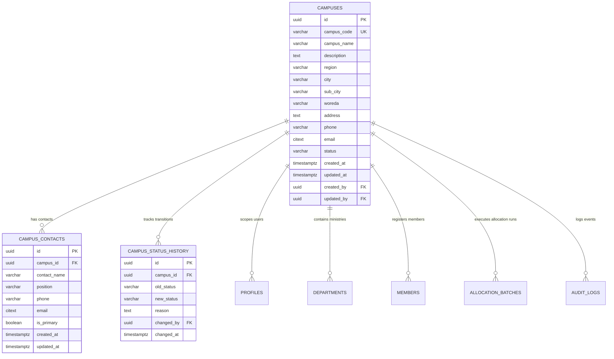
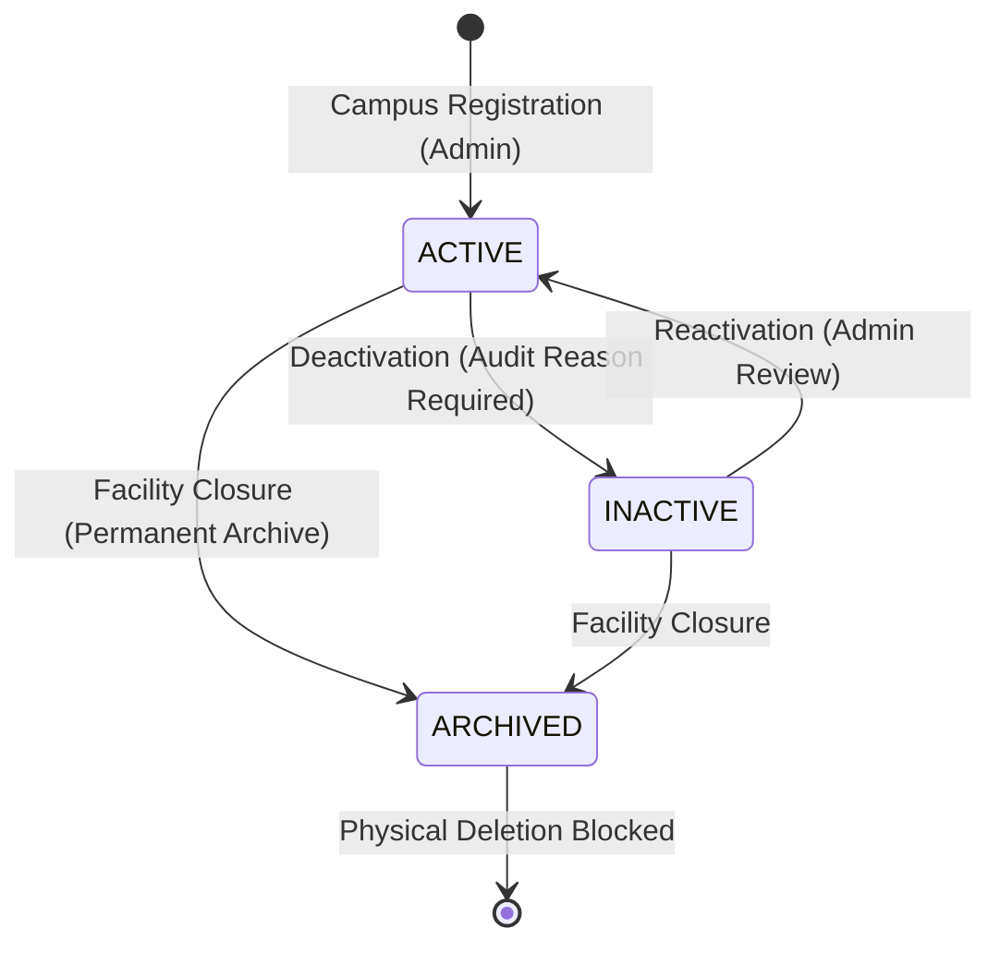

# C-CIMAS Module 1: Campus Management — Database Architecture & Technical Specification

> **Project**: Church Campus Information Management and Allocation System (C-CIMAS)  
> **Module**: 01 — Campus Management  
> **Database Engine**: PostgreSQL 15+ / Supabase  
> **Status**: Verified & Production-Ready  
> **Last Updated**: 2026-11-13  

---

## 1. Executive Summary

Module 1 (Campus Management) forms the organizational cornerstone and tenancy root of the C-CIMAS platform. Every subsequent entity in the system—including departments (Module 2), members (Module 3), Excel import staging (Module 4), eligibility filters (Module 5), capacity definitions (Module 6), and allocation batches (Module 7)—is bound by foreign key constraints to a specific `campus_id`.

Module 1 is engineered to guarantee:
1. **Multi-Tenant Isolation**: Complete isolation of campus operations, member registries, and quotas.
2. **Global Code Uniqueness**: Guaranteed normalization and case-insensitive uniqueness of `campus_code` across the diocese.
3. **Audit History & Immutability**: Full lifecycle transition tracking (Active $\to$ Inactive $\to$ Archived) with required administrative justification and immutable status journals.
4. **Row-Level Security (RLS)**: Enforced boundary control where System Administrators retain global governance while Campus Officers and Evaluators are strictly scoped to their assigned campus tenant.

---

## 2. Entity Relationship Diagram (ERD)



---

## 3. Database Schema & Table Specifications

### 3.1 `campuses` Table
Stores diocesan campus entities.

```sql
CREATE TABLE IF NOT EXISTS campuses (
    id UUID PRIMARY KEY DEFAULT uuid_generate_v4(),
    campus_code VARCHAR(30) NOT NULL,
    campus_name VARCHAR(150) NOT NULL,
    description TEXT,
    region VARCHAR(100),
    city VARCHAR(100) NOT NULL,
    sub_city VARCHAR(100),
    woreda VARCHAR(100),
    address TEXT,
    phone VARCHAR(50),
    email CITEXT,
    status VARCHAR(20) NOT NULL DEFAULT 'ACTIVE',
    created_at TIMESTAMPTZ NOT NULL DEFAULT NOW(),
    updated_at TIMESTAMPTZ NOT NULL DEFAULT NOW(),
    created_by UUID REFERENCES auth.users(id),
    updated_by UUID REFERENCES auth.users(id),

    -- Constraints
    CONSTRAINT chk_campuses_code_not_empty CHECK (LENGTH(TRIM(campus_code)) >= 2),
    CONSTRAINT chk_campuses_name_not_empty CHECK (LENGTH(TRIM(campus_name)) >= 2),
    CONSTRAINT chk_campuses_status CHECK (status IN ('ACTIVE', 'INACTIVE', 'ARCHIVED')),
    CONSTRAINT chk_campuses_email_valid CHECK (email IS NULL OR email ~* '^[A-Za-z0-9._%+-]+@[A-Za-z0-9.-]+\.[A-Za-z]{2,}$')
);

-- Case-insensitive unique code index
CREATE UNIQUE INDEX IF NOT EXISTS uq_campuses_code_upper ON campuses (UPPER(TRIM(campus_code)));
CREATE INDEX IF NOT EXISTS idx_campuses_status ON campuses (status);
CREATE INDEX IF NOT EXISTS idx_campuses_city ON campuses (city);
CREATE INDEX IF NOT EXISTS idx_campuses_region ON campuses (region);
```

### 3.2 `campus_contacts` Table
Supports multiple contact persons per campus with a strict partial unique index guaranteeing exactly **one primary contact**.

```sql
CREATE TABLE IF NOT EXISTS campus_contacts (
    id UUID PRIMARY KEY DEFAULT uuid_generate_v4(),
    campus_id UUID NOT NULL REFERENCES campuses(id) ON DELETE CASCADE,
    contact_name VARCHAR(150) NOT NULL,
    position VARCHAR(100),
    phone VARCHAR(50) NOT NULL,
    email CITEXT,
    is_primary BOOLEAN NOT NULL DEFAULT FALSE,
    created_at TIMESTAMPTZ NOT NULL DEFAULT NOW(),
    updated_at TIMESTAMPTZ NOT NULL DEFAULT NOW(),

    CONSTRAINT chk_contacts_name_not_empty CHECK (LENGTH(TRIM(contact_name)) >= 2)
);

-- Partial Unique Index: Exactly one primary contact per campus
CREATE UNIQUE INDEX IF NOT EXISTS uq_campus_contacts_single_primary 
ON campus_contacts (campus_id) 
WHERE (is_primary = TRUE);

CREATE INDEX IF NOT EXISTS idx_campus_contacts_campus_id ON campus_contacts(campus_id);
```

### 3.3 `campus_status_history` Table
Immutable historical ledger documenting operational status transitions.

```sql
CREATE TABLE IF NOT EXISTS campus_status_history (
    id UUID PRIMARY KEY DEFAULT uuid_generate_v4(),
    campus_id UUID NOT NULL REFERENCES campuses(id) ON DELETE CASCADE,
    old_status VARCHAR(20) NOT NULL,
    new_status VARCHAR(20) NOT NULL,
    reason TEXT NOT NULL,
    changed_by UUID NOT NULL REFERENCES auth.users(id),
    changed_at TIMESTAMPTZ NOT NULL DEFAULT NOW(),

    CONSTRAINT chk_status_history_reason CHECK (LENGTH(TRIM(reason)) >= 3)
);

CREATE INDEX IF NOT EXISTS idx_campus_status_history_campus ON campus_status_history(campus_id);
CREATE INDEX IF NOT EXISTS idx_campus_status_history_changed_at ON campus_status_history(changed_at DESC);
```

---

## 4. Status Transition Lifecycle & Business Rules



1. **ACTIVE**:
   - Authorized to create and manage departments.
   - Authorized to receive new member registrations and Excel bulk imports.
   - Eligible to initiate intelligent quota allocation runs.
2. **INACTIVE**:
   - Campus operations temporarily suspended.
   - Read-only access for existing records.
   - Blocked from importing Excel batches or initiating new allocation runs.
3. **ARCHIVED**:
   - Facility closed or merged.
   - Physical deletion (`DELETE FROM campuses`) is disallowed at application and database trigger level.
   - All historical records, member rosters, and audit trails remain permanently queryable.

---

## 5. Supabase Row Level Security (RLS) Model

RLS guarantees database-enforced security regardless of whether requests arrive from REST, GraphQL, or direct Supabase client queries.

```sql
-- Enable RLS on all tables
ALTER TABLE campuses ENABLE ROW LEVEL SECURITY;
ALTER TABLE campus_contacts ENABLE ROW LEVEL SECURITY;
ALTER TABLE campus_status_history ENABLE ROW LEVEL SECURITY;

-- 1. SELECT Policy
CREATE POLICY rls_campuses_select ON campuses
    FOR SELECT TO authenticated
    USING (
        auth.jwt() ->> 'role' = 'ADMIN' OR
        id = (auth.jwt() ->> 'campus_id')::UUID OR
        status = 'ACTIVE'
    );

-- 2. INSERT Policy (Global Admin Only)
CREATE POLICY rls_campuses_insert ON campuses
    FOR INSERT TO authenticated
    WITH CHECK (auth.jwt() ->> 'role' = 'ADMIN');

-- 3. UPDATE Policy (Global Admin Only)
CREATE POLICY rls_campuses_update ON campuses
    FOR UPDATE TO authenticated
    USING (auth.jwt() ->> 'role' = 'ADMIN')
    WITH CHECK (auth.jwt() ->> 'role' = 'ADMIN');

-- 4. DELETE Policy (Strictly Restricted)
CREATE POLICY rls_campuses_delete ON campuses
    FOR DELETE TO authenticated
    USING (auth.jwt() ->> 'role' = 'ADMIN' AND status != 'ARCHIVED');
```

---

## 6. Integration Contract for Subsequent Modules

| Downstream Module | Foreign Key Dependency | Integration Guarantees |
| :--- | :--- | :--- |
| **Module 2: Department Management** | `departments.campus_id -> campuses.id` | Ministry codes and percentage target cycles are scoped per campus. |
| **Module 3: Member Management** | `members.campus_id -> campuses.id` | Every member is strictly assigned to exactly one campus. Cross-campus duplicate detection runs across all campuses. |
| **Module 4: Excel Bulk Import** | `import_batches.campus_id -> campuses.id` | Staging batches check campus status (`ACTIVE` check). |
| **Module 7: Allocation Engine** | `allocation_batches.campus_id -> campuses.id` | Quota distribution runs within the campus boundary, accounting for 100% of campus members. |
| **Module 12: Audit & History** | `audit_logs.campus_id -> campuses.id` | Every change to campus metadata, codes, or status emits an audit log. |

---

## 7. Verification & Automated Test Coverage

The test suite in `backend/tests/campus.test.ts` validates:
- [x] Campus listing with role-based filtering.
- [x] Global uniqueness of campus codes (rejecting duplicates case-insensitively).
- [x] Input validation (mandatory fields, valid email format, non-empty code).
- [x] Safe updates and code changes.
- [x] Status toggle (`ACTIVE` $\leftrightarrow$ `INACTIVE`).
- [x] Non-admin access control enforcement.

