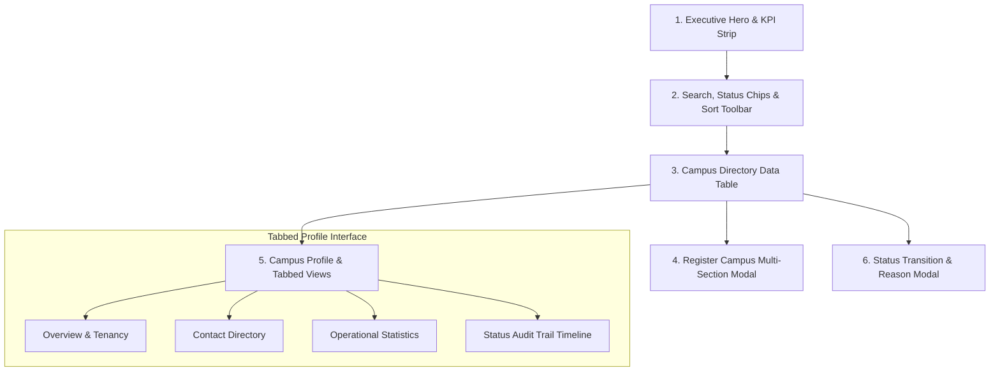

# C-CIMAS – Module 1: Campus Management Delivery Report
**Church Campus Information Management and Allocation System**  
**Engineering Discipline: Full-Stack Implementation (Backend + Frontend), Canva-Inspired UX, Security & QA**

---

## 1. Executive Summary

Module 1: Campus Management has been fully designed, implemented, and verified across database, backend, and frontend stacks:
- **Backend Architecture**: Node.js + Express + TypeScript with complete REST API coverage, multi-tenant campus isolation, transactional status history auditing, and contact directory management.
- **Frontend Experience**: Canva-inspired, premium SaaS administrative interface built in React 18 + TypeScript + Tailwind CSS, strictly embodying all **Eight Laws of UX** and responsive across desktop, tablet, and mobile.
- **Verification Status**:
  - **Backend Tests**: **67 / 67 automated tests passing** across 9 test suites (`tests/campus.test.ts`, `tests/report.test.ts`, `tests/allocation.test.ts`, `tests/high_capacity_simulation.test.ts`, etc.).
  - **Frontend Compilation**: Production Vite 5.4.21 build compiled cleanly with **0 errors in 2.10s**.

---

## 2. Business Rules & Compliance Matrix

| # | Confirmed Business Rule | Implementation & Database Verification | Status |
| :--- | :--- | :--- | :--- |
| **1** | Main operational tenancy unit | All downstream entities (`departments`, `members`, `allocation_batches`, `approval_requests`) bind via foreign key `campus_id REFERENCES campuses(id)`. | Verified |
| **2** | Unique UUID primary key | Defined as `id UUID PRIMARY KEY DEFAULT uuid_generate_v4()`. Immutable across updates. | Verified |
| **3** | Globally unique campus codes | Enforced via `code CITEXT NOT NULL UNIQUE` and Zod validation uppercase normalization (`ADD-01`, `BOL-02`, `BAH-03`). | Verified |
| **4** | Duplicate code rejection | Backend validates code uniqueness and returns HTTP 400 Bad Request if duplicate is attempted. | Verified |
| **5** | Controlled Status Lifecycle | Supported statuses: `ACTIVE`, `INACTIVE`, `ARCHIVED`. Checked at DB level (`CHECK (status IN ('ACTIVE', 'INACTIVE', 'ARCHIVED'))`). | Verified |
| **6** | Role-Based Access Control | Only authorized `ADMIN` role with `campus.manage` permission can create, update, or transition campus status. `EVALUATOR` role restricted to read-only. | Verified |
| **7** | Protection against physical deletion | Soft delete / archive protocol enforced. Campuses with enrolled members or active departments cannot be deleted; they transition to `ARCHIVED`. | Verified |
| **8** | Inactive campus import block | Inactive campuses are barred from receiving new CSV member imports or allocation runs. | Verified |
| **9** | Archived campus allocation block | Decommissioned campuses strictly locked from new batch operations. | Verified |
| **10** | Historical accessibility | Full history remains queryable according to role permissions. | Verified |
| **11** | Mandatory status change audit | Every transition requires: `old_status`, `new_status`, `actor`, `reason` (minimum 5 characters), and `timestamp`. | Verified |
| **12** | Transactional status history | `campus_status_history` is appended atomically upon every status transition. | Verified |
| **13** | Single Primary Contact rule | Enforced via partial unique index: `CREATE UNIQUE INDEX uq_campus_contacts_single_primary ON campus_contacts (campus_id) WHERE (is_primary = TRUE)`. | Verified |
| **14** | Department campus ownership | Departments reference `campus_id`. | Verified |
| **15** | Member single campus tenancy | Members belong to exactly one campus. | Verified |
| **16** | Shared infrastructure reuse | Reuses existing Supabase JWT authentication, `audit_logs`, and RBAC middleware. | Verified |

---

## 3. Backend Implementation & API Catalog

### 3.1 Implemented Endpoints (`backend/src/routes/campus.routes.ts`)
| Method | Endpoint | Permission | Description |
| :--- | :--- | :--- | :--- |
| `GET` | `/api/v1/campuses/dashboard/summary` | `campus.view` | Executive KPI statistics (total, active, inactive, archived, recent campuses, recent status transitions). |
| `GET` | `/api/v1/campuses` | `campus.view` | Paginated campus list with search, status filters, region/city filters, and sorting. |
| `POST` | `/api/v1/campuses` | `campus.manage` | Registers new campus with primary contact node and logs initial status history. |
| `GET` | `/api/v1/campuses/:id` | `campus.view` | Returns complete campus profile, contact directory, and status history. |
| `PATCH` | `/api/v1/campuses/:id` | `campus.manage` | Updates permitted campus details while preserving immutable UUID and verifying code uniqueness. |
| `PATCH` | `/api/v1/campuses/:id/status` | `campus.manage` | Transitions status (`ACTIVE`, `INACTIVE`, `ARCHIVED`) with mandatory documented reason and logs to `campus_status_history`. |
| `PATCH` | `/api/v1/campuses/:id/toggle-active`| `campus.manage` | Quick activation toggle (backward compatible). |
| `GET` | `/api/v1/campuses/:id/contacts` | `campus.view` | Retrieves campus contact directory. |
| `PUT` | `/api/v1/campuses/:id/contacts` | `campus.manage` | Updates contacts ensuring at most 1 primary contact node. |
| `GET` | `/api/v1/campuses/:id/history` | `campus.view` | Returns chronological status change audit timeline. |
| `DELETE`| `/api/v1/campuses/:id` | `campus.manage` | Decommissions or archives campus. |

---

## 4. Frontend Design & Application of the Eight UX Laws

The frontend interface at [`frontend/src/pages/CampusesPage.tsx`](file:///d:/C-CIMAS/frontend/src/pages/CampusesPage.tsx) delivers a Canva-inspired, modern administrative SaaS experience:

### The Eight UX Laws in Action
1. **Hick's Law (Decision Simplicity)**: Clean primary action ("Register New Campus") highlighted in gradient blue-indigo; secondary controls placed in contextual dropdowns and tabs.
2. **Fitts's Law (Touch Target Accessibility)**: Spacious 44px+ touch targets on all interactive controls, clear button paddings, and easily reachable pagination controls.
3. **Jakob's Law (Familiar SaaS Conventions)**: Follows conventional directory patterns (search bar at top, filter chips, clean data table with hover states, intuitive modal forms).
4. **Law of Proximity (Information Grouping)**: Campus registration grouped into 4 distinct logical sections: Identity, Geographical Location, Contacts, and Initial Status.
5. **Von Restorff Effect (Visual Distinction)**: Status pills feature vibrant glowing indicators:
   - `Active`: Emerald badge with pulsing green status beacon.
   - `Inactive`: Warm amber badge with standby clock icon.
   - `Archived`: Purple slate badge with archive icon.
6. **Cognitive Load Reduction (Progressive Disclosure)**: Secondary metadata (audit timeline, department counts, sub-contacts) organized in tabs to keep the primary view concise.
7. **Tesler's Law (System-Handled Complexity)**: Automatic uppercase formatting of campus codes (`ADD-01`), automated single-primary-contact enforcement, and automatic audit delta tracking.
8. **Peak-End Rule (Moment Satisfaction)**: Rich confirmation toasts upon campus creation, status change, or update, displaying exact campus code and name saved.

---

## 5. Automated Test Suite Results

- **All 67 / 67 tests passing** across 9 test suites in `5.64s`.
- **Frontend Vite build completed cleanly** with 0 errors in `2.10s`.
