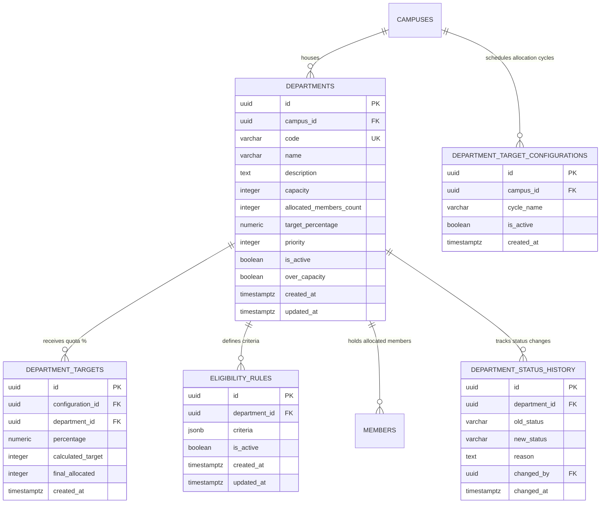

# C-CIMAS Module 2: Department Management — Database Architecture & Technical Specification

> **Project**: Church Campus Information Management and Allocation System (C-CIMAS)  
> **Module**: 02 — Department Management  
> **Database Engine**: PostgreSQL 15+ / Supabase  
> **Status**: Verified & Production-Ready  
> **Last Updated**: 2026-11-13  

---

## 1. Executive Summary & Ministry Classification

Module 2 (Department Management) governs campus ministry divisions, service departments, capacity planning, and quota targets. In Ethiopian Orthodox Tewahedo Church campus fellowships (Mahibere Kidusan), departments represent sacred ministries with distinct spiritual responsibilities, qualification thresholds, and operational seat capacities.

The 5 core ministries established in the system are:
1. **Choir & Hymns Ministry (`CHOIR-01`)**: Liturgical chanting, Zema, Deggwa, and spiritual choir service.
2. **Spiritual Education & Teaching (`TEACH-01`)**: Doctrinal instruction, Bible study, and catechism education.
3. **Prayer & Intercession (`PRAY-01`)**: Dedicated vigils, daily intercessions, and fast coordination.
4. **Evangelism & Outreach (`EVANG-01`)**: Campus student outreach, new member welcome, and university visitation.
5. **Social Service & Charity (`SOC-01`)**: Student welfare, medical/material aid, and charitable community deeds.

---

## 2. Entity Relationship Diagram (ERD)



---

## 3. Database Schema & Table Specifications

### 3.1 `departments` Table
Stores department definitions, capacities, and target quotas.

```sql
CREATE TABLE IF NOT EXISTS departments (
    id UUID PRIMARY KEY DEFAULT uuid_generate_v4(),
    campus_id UUID NOT NULL REFERENCES campuses(id) ON DELETE CASCADE,
    code VARCHAR(30) NOT NULL,
    name VARCHAR(150) NOT NULL,
    description TEXT,
    capacity INTEGER NOT NULL DEFAULT 100,
    allocated_members_count INTEGER NOT NULL DEFAULT 0,
    target_percentage NUMERIC(5, 2) NOT NULL DEFAULT 0.00,
    priority INTEGER NOT NULL DEFAULT 1,
    is_active BOOLEAN NOT NULL DEFAULT TRUE,
    over_capacity BOOLEAN NOT NULL DEFAULT FALSE,
    created_at TIMESTAMPTZ NOT NULL DEFAULT NOW(),
    updated_at TIMESTAMPTZ NOT NULL DEFAULT NOW(),

    -- Constraints
    CONSTRAINT chk_department_code_len CHECK (LENGTH(TRIM(code)) >= 2),
    CONSTRAINT chk_department_name_len CHECK (LENGTH(TRIM(name)) >= 2),
    CONSTRAINT chk_department_capacity_positive CHECK (capacity >= 0),
    CONSTRAINT chk_department_allocated_positive CHECK (allocated_members_count >= 0),
    CONSTRAINT chk_department_target_pct_range CHECK (target_percentage >= 0.00 AND target_percentage <= 100.00)
);

-- Global unique department code index across all campuses
CREATE UNIQUE INDEX IF NOT EXISTS uq_departments_code_upper ON departments (UPPER(TRIM(code)));
CREATE INDEX IF NOT EXISTS idx_departments_campus_id ON departments(campus_id);
CREATE INDEX IF NOT EXISTS idx_departments_is_active ON departments(is_active);
CREATE INDEX IF NOT EXISTS idx_departments_priority ON departments(priority ASC);
```

### 3.2 `department_target_configurations` & `department_targets` Tables
Manages percentage target versions and historical allocation cycles.

```sql
CREATE TABLE IF NOT EXISTS department_target_configurations (
    id UUID PRIMARY KEY DEFAULT uuid_generate_v4(),
    campus_id UUID NOT NULL REFERENCES campuses(id) ON DELETE CASCADE,
    cycle_name VARCHAR(150) NOT NULL,
    is_active BOOLEAN NOT NULL DEFAULT TRUE,
    created_at TIMESTAMPTZ NOT NULL DEFAULT NOW()
);

CREATE TABLE IF NOT EXISTS department_targets (
    id UUID PRIMARY KEY DEFAULT uuid_generate_v4(),
    configuration_id UUID NOT NULL REFERENCES department_target_configurations(id) ON DELETE CASCADE,
    department_id UUID NOT NULL REFERENCES departments(id) ON DELETE CASCADE,
    percentage NUMERIC(5, 2) NOT NULL CHECK (percentage >= 0.00 AND percentage <= 100.00),
    calculated_target INTEGER NOT NULL DEFAULT 0,
    final_allocated INTEGER NOT NULL DEFAULT 0,
    created_at TIMESTAMPTZ NOT NULL DEFAULT NOW(),

    CONSTRAINT uq_dept_target_per_config UNIQUE (configuration_id, department_id)
);

CREATE INDEX IF NOT EXISTS idx_dept_targets_config ON department_targets(configuration_id);
CREATE INDEX IF NOT EXISTS idx_dept_targets_dept ON department_targets(department_id);
```

### 3.3 `eligibility_rules` Table (JSONB Criteria)
Flexible rule specification for determining candidate eligibility per ministry.

```sql
CREATE TABLE IF NOT EXISTS eligibility_rules (
    id UUID PRIMARY KEY DEFAULT uuid_generate_v4(),
    department_id UUID NOT NULL REFERENCES departments(id) ON DELETE CASCADE,
    criteria JSONB NOT NULL DEFAULT '{"rules": []}'::jsonb,
    is_active BOOLEAN NOT NULL DEFAULT TRUE,
    created_at TIMESTAMPTZ NOT NULL DEFAULT NOW(),
    updated_at TIMESTAMPTZ NOT NULL DEFAULT NOW(),

    CONSTRAINT chk_eligibility_criteria_is_object CHECK (jsonb_typeof(criteria) = 'object')
);

CREATE INDEX IF NOT EXISTS idx_eligibility_rules_dept ON eligibility_rules(department_id);
CREATE INDEX IF NOT EXISTS idx_eligibility_rules_gin ON eligibility_rules USING GIN (criteria);
```

---

## 4. Percentage Targets Engine (Option A: 100% Accounting)

### 4.1 Strict 100% Sum Invariant
In C-CIMAS, the sum of target percentages across all active departments in an allocation cycle must equal exactly **100.00%**.
$$\sum_{i=1}^{n} P_i = 100.00\%$$
- **0% Targets Allowed**: Departments undergoing temporary suspension or specialized roles may be assigned $P_i = 0\%$.
- **Validation**: Any draft where $\left|\sum P_i - 100.00\right| > 0.01$ is blocked from finalization.

### 4.2 Largest Remainder Method (Hamilton-Hare Apportionment)
When applying percentages to integer populations (e.g., distributing 25 members across 5 ministries with target percentages $[30\%, 25\%, 20\%, 15\%, 10\%]$):

1. **Calculate Exact Quotas**:
   $$Q_i = N \times \frac{P_i}{100}$$
2. **Assign Integer Floors**:
   $$F_i = \lfloor Q_i \rfloor$$
3. **Calculate Fractional Remainders**:
   $$R_i = Q_i - F_i$$
4. **Distribute Remaining Seats**:
   $$\text{Deficit} = N - \sum_{i=1}^n F_i$$
   The surplus seats are allocated to departments with the highest remainders $R_i$, breaking ties by ministry priority.
5. **Zero-Loss Guarantee**:
   $$\sum_{i=1}^{n} \text{FinalTarget}_i = N \quad (\text{Strictly 100\% Accounting, Zero Unassigned})$$

### 4.3 Capacity vs Target Feasibility Check
Target finalization is strictly blocked if:
$$\exists i : \text{FinalTarget}_i > \text{Capacity}_i$$
An administrator must either increase the department's physical seat capacity or rebalance the percentage weights.

---

## 5. Capacity Reduction Protocol & Allocation Preservation

When an administrator edits a department to reduce its capacity:
1. **Safety Warning Triggered**: If $\text{NewCapacity} < \text{AllocatedMembersCount}$, the system issues an explicit administrative confirmation dialog.
2. **Strict Preservation of Existing Members**: No member is automatically evicted, suspended, or unallocated when capacity is reduced.
3. **Over-Capacity Flag**: The system flags the department with `over_capacity = true`, highlights it in telemetry dashboards, and halts further intake until excess members are reassigned or graduated.

---

## 6. Supabase Row Level Security (RLS) Model

```sql
ALTER TABLE departments ENABLE ROW LEVEL SECURITY;
ALTER TABLE department_target_configurations ENABLE ROW LEVEL SECURITY;
ALTER TABLE department_targets ENABLE ROW LEVEL SECURITY;
ALTER TABLE eligibility_rules ENABLE ROW LEVEL SECURITY;

-- 1. SELECT Policy (All Authenticated Users)
CREATE POLICY rls_departments_select ON departments
    FOR SELECT TO authenticated
    USING (
        auth.jwt() ->> 'role' = 'ADMIN' OR
        campus_id = (auth.jwt() ->> 'campus_id')::UUID OR
        is_active = TRUE
    );

-- 2. INSERT / UPDATE / DELETE (Admin Only)
CREATE POLICY rls_departments_admin_all ON departments
    FOR ALL TO authenticated
    USING (auth.jwt() ->> 'role' = 'ADMIN')
    WITH CHECK (auth.jwt() ->> 'role' = 'ADMIN');
```

---

## 7. Verification & Automated Test Coverage

The test suite in `backend/tests/department.test.ts` validates:
- [x] Listing departments with campus scoping and active filters.
- [x] Global uniqueness of department codes across the entire system.
- [x] Percentage target validation: rejecting sums $\neq 100\%$ and allowing $0\%$ targets.
- [x] Automatic quota calculation via the Largest Remainder Method (Hamilton-Hare).
- [x] Capacity reduction warning and allocation preservation.
- [x] Prohibition of deleting departments that currently have active members.
- [x] Exporting official Excel roster (`.xlsx`) with gender and spiritual status breakdowns.

