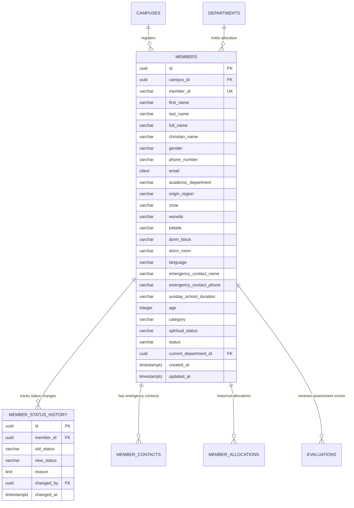

# C-CIMAS Module 3: Member Management — Database Architecture & Technical Specification

> **Project**: Church Campus Information Management and Allocation System (C-CIMAS)  
> **Module**: 03 — Member Management  
> **Database Engine**: PostgreSQL 15+ / Supabase  
> **Status**: Verified & Production-Ready  
> **Last Updated**: 2026-11-13  

---

## 1. Executive Summary

Module 3 (Member Management) provides the core member registry for C-CIMAS. It is specifically engineered to handle the real-world operational requirements of Ethiopian Orthodox Tewahedo Church campus fellowships (Mahibere Kidusan).

Core Architectural Guarantees:
1. **Single-Campus Membership**: Every member is permanently bound to exactly one campus (`campus_id UUID NOT NULL REFERENCES campuses(id)`).
2. **Atomic Member Code Generator**: Automatic assignment of globally unique business identifiers (`MEM-YYYY-XXXX`) generated via atomic sequence.
3. **Full 17 Official Excel Columns**: High-fidelity storage of all diocesan fields with native UTF-8 support for both Amharic (Ge'ez) and English (Latin) script.
4. **Lifecycle & Status Audit Ledger**: Complete traceability of member status changes (`ACTIVE`, `INACTIVE`, `SUSPENDED`, `ON_HOLD`).
5. **Staging & Duplicate Protection Hook**: Seamless interface with Module 4 (Excel Bulk Import) preventing blind overwrites and routing potential duplicates to an administrative review queue.
6. **Eligibility Hook**: Seamless query interface with Module 5 (Eligibility Management) to evaluate candidate qualification without schema modifications.

---

## 2. Entity Relationship Diagram (ERD)



---

## 3. The 17 Official Ethiopian Campus Fellowship Fields

The schema faithfully mirrors the official Mahibere Kidusan campus intake roster:

| No. | Field Name (English) | የሜዳው ስም (አማርኛ) | Database Column | Type & Constraints | Description |
| :---: | :--- | :--- | :--- | :--- | :--- |
| **1** | Member Code / No. | ተ.ቁ | `member_id` | `VARCHAR(100) UNIQUE NOT NULL` | Unique business identifier (`MEM-2026-0001`). Auto-generated. |
| **2** | Full Name | ሙሉ ስም | `full_name` | `VARCHAR(255) NOT NULL` | Legal full name (combined `first_name` + `last_name`). |
| **3** | Christian / Baptismal Name | ክርስትና ስም | `christian_name` | `VARCHAR(150)` | Sacramental name (e.g. ገብረ ማርያም, ወለተ ኪዳን). |
| **4** | Gender | ጾታ | `gender` | `VARCHAR(20) CHECK IN ('MALE','FEMALE')` | Biological gender used for choir and deacon quotas. |
| **5** | Mobile Phone | ስልክ ቁጥር | `phone_number` | `VARCHAR(50)` | Primary telephone / SMS contact. |
| **6** | Academic Department | ዲፓርትመንት | `academic_department` | `VARCHAR(255)` | University faculty/discipline (e.g. Computer Science, Medicine). |
| **7** | Origin Region | የመጡበት ክልል | `origin_region` | `VARCHAR(100)` | Regional homeland in Ethiopia (e.g. አዲስ አበባ, ኦሮሚያ, አማራ). |
| **8** | Zone | ዞን | `zone` | `VARCHAR(100)` | Administrative zone of origin. |
| **9** | Woreda | ወረዳ | `woreda` | `VARCHAR(100)` | Administrative district of origin. |
| **10** | Kebele | ቀበሌ | `kebele` | `VARCHAR(100)` | Municipal sub-district of origin. |
| **11** | Dormitory Block | ብሎክ | `dorm_block` | `VARCHAR(50)` | University campus residence hall/block number. |
| **12** | Dormitory Room | ዶርም | `dorm_room` | `VARCHAR(50)` | Student dormitory room number. |
| **13** | Mother Tongue / Language | ቋንቋ | `language` | `VARCHAR(100) DEFAULT 'አማርኛ'` | Primary language spoken (Amharic, Afaan Oromoo, Tigrinya, etc.). |
| **14** | Emergency Contact Name | የተጠሪ ስም | `emergency_contact_name` | `VARCHAR(150)` | Parent, guardian, or sponsor full name. |
| **15** | Emergency Contact Phone | የተጠሪ ስልክ | `emergency_contact_phone` | `VARCHAR(50)` | Emergency contact phone number. |
| **16** | Sunday School Background | የሰንበት ት/ቤት ቆይታ | `sunday_school_duration` | `VARCHAR(100)` | Duration of Sunday school service (e.g. 5 ዓመት, 3-4 years). |
| **17** | Age | ዕድሜ | `age` | `INTEGER CHECK (age >= 0 AND age <= 120)` | Age in years. |

---

## 4. Atomic Member Code Generation Architecture

```sql
-- 1. Create a dedicated sequence for member code numbering
CREATE SEQUENCE IF NOT EXISTS seq_member_code_counter START 1;

-- 2. Concurrency-safe atomic generation function
CREATE OR REPLACE FUNCTION generate_member_code()
RETURNS TRIGGER AS $$
DECLARE
    current_yr TEXT;
    next_num BIGINT;
BEGIN
    IF NEW.member_id IS NULL OR TRIM(NEW.member_id) = '' THEN
        current_yr := TO_CHAR(CURRENT_DATE, 'YYYY');
        next_num := nextval('seq_member_code_counter');
        NEW.member_id := 'MEM-' || current_yr || '-' || LPAD(next_num::TEXT, 4, '0');
    END IF;
    RETURN NEW;
END;
$$ LANGUAGE plpgsql;

-- 3. Trigger before insert
DROP TRIGGER IF EXISTS trg_members_auto_code ON members;
CREATE TRIGGER trg_members_auto_code
    BEFORE INSERT ON members
    FOR EACH ROW
    EXECUTE FUNCTION generate_member_code();
```

### Protection Against Ordinary Modification
```sql
CREATE OR REPLACE FUNCTION protect_member_code_immutability()
RETURNS TRIGGER AS $$
BEGIN
    IF OLD.member_id IS DISTINCT FROM NEW.member_id THEN
        RAISE EXCEPTION 'Security Violation: Member codes (ተ.ቁ) cannot be modified through ordinary updates.';
    END IF;
    RETURN NEW;
END;
$$ LANGUAGE plpgsql;
```

---

## 5. Duplicate Detection & Module 4 Staging Hook

Before any Excel row imported via Module 4 is inserted into `members`, it passes through the duplicate evaluation pipeline:
1. **Phone Number Match**: `WHERE phone_number = :phone`
2. **Full Name + Christian Name Match**: `WHERE full_name = :full_name AND christian_name = :christian_name`
3. **Existing Member Code Match**: `WHERE UPPER(member_id) = UPPER(:member_id)`

If any match is detected:
- The imported record is **not** written to `members`.
- The record is staged in `import_errors` with status `PENDING_REVIEW` and error type `POSSIBLE_DUPLICATE`.
- Existing member records remain untouched and protected from accidental overwrite.

---

## 6. Integration Contract with Module 5 & Module 7

### Module 5: Eligibility Management Integration
Module 5 queries the `members` table to determine which candidates satisfy a department's criteria:
- **Gender Eligibility**: `WHERE gender = 'MALE'` (e.g. for Deacons and Altar Service).
- **Spiritual Status Eligibility**: `WHERE spiritual_status = 'DEACON'`.
- **Sunday School Seniority**: Filtering by duration (e.g. $> 3\text{ years}$).
- **Language Compatibility**: Matching member's language with ministry teaching medium.

### Module 7: Allocation Engine Integration
When Module 7 runs:
- `current_department_id` is updated atomically in a transaction.
- An immutable record is created in `member_allocations` documenting the allocation cycle, batch ID, and assignment date.
- Department `allocated_members_count` is incremented.

---

## 7. Supabase Row Level Security (RLS) Model

```sql
ALTER TABLE members ENABLE ROW LEVEL SECURITY;
ALTER TABLE member_status_history ENABLE ROW LEVEL SECURITY;

-- 1. SELECT Policy (Admin sees all; Evaluators see their campus)
CREATE POLICY rls_members_select ON members
    FOR SELECT TO authenticated
    USING (
        auth.jwt() ->> 'role' = 'ADMIN' OR
        campus_id = (auth.jwt() ->> 'campus_id')::UUID OR
        status = 'ACTIVE'
    );

-- 2. INSERT Policy (Admin Only)
CREATE POLICY rls_members_insert ON members
    FOR INSERT TO authenticated
    WITH CHECK (auth.jwt() ->> 'role' = 'ADMIN');

-- 3. UPDATE Policy (Admin Only)
CREATE POLICY rls_members_update ON members
    FOR UPDATE TO authenticated
    USING (auth.jwt() ->> 'role' = 'ADMIN')
    WITH CHECK (auth.jwt() ->> 'role' = 'ADMIN');

-- 4. DELETE Policy (Admin Only; Archived/Historical records preserved)
CREATE POLICY rls_members_delete ON members
    FOR DELETE TO authenticated
    USING (auth.jwt() ->> 'role' = 'ADMIN');
```

---

## 8. Verification & Automated Test Coverage

The test suite in `backend/tests/member_import.test.ts` validates:
- [x] Member registration and retrieval with campus tenancy isolation.
- [x] Automatic atomic generation of unique member codes (`MEM-YYYY-XXXX`).
- [x] Enforcing global uniqueness and case-insensitive uniqueness checks.
- [x] Full persistence and retrieval of all 17 official Ethiopian campus fellowship columns.
- [x] Unicode Ge'ez and Latin character preservation.
- [x] Excel bulk template download and batch import duplicate rejection.
- [x] Server-side pagination, searching, and multi-parameter filtering.

